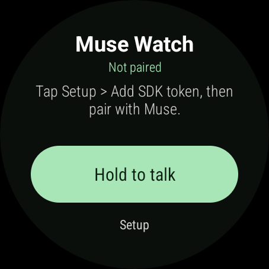

# Muse Watch

A small, independent Wear OS app that lets you talk to your Meta Muse agent from your wrist. **Hold the onscreen button to record; release to send.** Read the reply on your watch or hear it through Android text-to-speech.

This is a community prototype adapted from [Cameron Pak’s Muse r1](https://github.com/cameronapak/muse-r1), using Meta’s [Muse Gadget SDK](https://github.com/facebookincubator/muse-gadget-sdk). It is not an official Meta or Samsung product.

## Download

The links below download the prepared files directly. Release notes are available in [Releases](https://github.com/Moldman570/muse-watch/releases/tag/v0.3.0)

| Download | Use it for |
| --- | --- |
| [muse-watch-v0.3.0.apk](https://github.com/Moldman570/muse-watch/raw/refs/tags/v0.3.0/downloads/v0.3.0/muse-watch-v0.3.0.apk) | Install with a phone sideloading app or your own ADB setup |
| [muse-watch-windows-v0.3.0.zip](https://github.com/Moldman570/muse-watch/raw/refs/tags/v0.3.0/downloads/v0.3.0/muse-watch-windows-v0.3.0.zip) | Windows installation: includes the APK, helper, and Google’s official ADB tools |
| [SHA256SUMS.txt](https://github.com/Moldman570/muse-watch/raw/refs/tags/v0.3.0/downloads/v0.3.0/SHA256SUMS.txt) | Verify the downloaded files |

The APK is a debug-signed sideloading prototype. Future published updates need the same signing key to preserve app data. The private signing key is not included in this repository.

*Initial Wear OS 6 emulator capture from v0.2. The main interface is retained in v0.3; this is not a screenshot of a live Muse conversation.*

## What it does

- Records a voice message while you hold the green button and sends it when you release.
- Cancels recording when you slide upward. Each recording is limited to 20 seconds.
- Displays responses and reads them using Android text-to-speech.
- Pairs with Muse through the phone app using your own SDK token.
- Stores credentials encrypted in app-private storage using Android Keystore; credentials are excluded from backup.
- Uses foreground-only recording. Voice recordings are held in memory instead of being saved as audio files.

The app sends audio to Muse for processing. Meta’s handling of that audio is governed by its own terms and policies.

## What you need

A Wear OS watch, an Android phone with the Muse app, internet access, and your own [Muse Gadget SDK token](https://gadgets.muse.ai/settings/sdk-tokens). You also need wireless ADB or a phone sideloading app for installation. The app’s minimum Android API is 29, which is a build requirement rather than a guarantee of compatibility with every watch.

The project owner reports successful installation, pairing, and use on a **Samsung Galaxy Watch5 Pro running One UI Watch 8.0**. Other watches have not been confirmed. The Windows helper checks for a Watch5 Pro and stops on other models; use manual ADB for other watches.

## Install from Windows

1. Download and fully extract `muse-watch-windows-v0.3.0.zip` from Releases.
2. Put your watch and computer on the same home Wi-Fi. Keep the watch awake and unlocked.
3. Enable **ADB debugging** and **Wireless debugging** in the watch’s Developer options.
4. Double-click **Install.cmd** in the extracted folder.
5. Open **Pair new device** on the watch. Enter its pairing IP:port and six-digit code when the installer asks. Keep that pairing screen open until it succeeds.
6. Return to the **main Wireless debugging screen** and enter its connection IP:port. **This uses a different port from pairing.**
7. The helper installs the app without clearing its data. You can optionally enter your SDK token in a hidden prompt, or add it on the watch afterward.

The helper runs PowerShell with an execution-policy bypass for that process only. It does not change the computer’s permanent execution policy. The owner reports that the supplied Windows installation workflow worked; it was not executed on Windows in the cloud build session.

For manual commands and troubleshooting, see [WATCH-SETUP.md](WATCH-SETUP.md).

## Install from your phone

See [PHONE-START-HERE.md](PHONE-START-HERE.md). In Wear Installer 2, first pair using the code and port from **Pair new device**. Then connect with the port from the main Wireless debugging screen and choose **Custom APK**. A Bluetooth connection to Galaxy Wearable alone does not provide wireless ADB access.

## Connect to Muse

Installing the app and pairing your Muse account are separate steps.

1. Get your own token at [Muse SDK tokens](https://gadgets.muse.ai/settings/sdk-tokens). Review the [Gadget SDK Terms](https://gadgets.muse.ai/sdk-terms).
2. On the watch, choose **Setup → Add SDK token**, enter it, and save. Skip this if the Windows helper already imported it. The token dialog scrolls; swipe to reach its controls.
3. Choose **Setup → Pair / reconnect**.
4. On your phone, open **Muse → Settings → Devices**, enable **Developer mode**, and add the matching **MuseGadget…** device. Select **Current connection** if prompted.
5. Once connected, hold the green button. Grant microphone permission if prompted, then hold again, speak, and release. Keep the app open for the reply.

Never put your token in GitHub issues, screenshots, source code, or a shared APK. Every user supplies their own token. Turn off wireless debugging after installation.

## Buttons and limitations

Samsung’s assistant shortcut can open the app if the firmware allows selecting it as the assistant; the owner reports this works on their watch. It still records through the **onscreen** button. Holding and releasing the physical Home/power button does not control recording in this release. Ordinary app launch never starts the microphone automatically.

This is intentionally a light prototype. It needs network access and runs in the foreground. Wi-Fi is the only confirmed connection route so far; internet relayed through the paired phone and standalone watch LTE have not been tested. The app reconnects when brought to the foreground, so the first connection can take a few seconds. Speech uses Android TTS, not Muse’s native voice; an English voice may need downloading. Battery use, latency, and compatibility across other firmware versions have not been measured. If delivery is uncertain, check Muse on your phone before resending to avoid duplicates.

## Source and personal credentials

This repository distributes the prebuilt app and installation helpers. The app's full source code is not part of this release. You do not need it to connect your own Muse account: install the APK, then enter your own token on the watch or through the Windows helper.

No publisher SDK token, pairing credentials, signing key, or account access is bundled in the app or installer.

## Verification and feedback

The v0.3 build passed 34 JVM tests, Android lint with documented scoped exclusions, and APK signature verification. An official Wear OS 6 emulator verified installation, launch, initial round-screen layout, and unpaired controls. Software emulation was unstable; the corrected token dialog’s final visual retest remained incomplete. The owner later reported that the installed app worked well on their physical Watch5 Pro. See [VERIFICATION.md](VERIFICATION.md) for the distinction between those checks.

[Open an issue](https://github.com/Moldman570/muse-watch/issues) with your watch model, firmware, app version, and a short description of what happened. Bug reports and reports from other watches are welcome. Remove tokens, pairing codes, account details, and conversations from any attached logs.

## Credits and license

- [Cameron Pak / Muse r1](https://github.com/cameronapak/muse-r1), upstream commit `c0dd741f0896f85540625d52be01750672e00eca`: MIT first-party code.
- [Meta Muse Gadget SDK](https://github.com/facebookincubator/muse-gadget-sdk): Apache-2.0 pairing and transport components.
- Southern Storm Noise implementation: MIT, with its own notices.

See [LICENSE](LICENSE), [NOTICE.md](NOTICE.md), and the notices in [licenses/](licenses/). The Windows bundle includes unmodified Google Platform-Tools with their license notices. No SDK token, paired-device credential, signing key, or account access is included.
